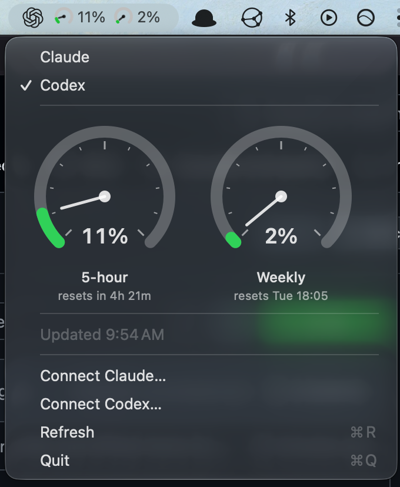

# ClaudeBar



A tiny macOS menu-bar app that shows **Claude or Codex** usage limits. Select a provider in the menu; its logo (Claude starburst or OpenAI Blossom for Codex) and usage gauges appear in the menu bar. Your selection is remembered across launches.

The menu bar shows usage gauges with percentages used. Claude shows 5-hour and weekly windows; Codex shows the windows available for your account. Click it to see larger dials with reset times, a last-updated time, and Refresh / Quit items. Gauges turn green below 50%, orange below 80%, and red at 80% and above.

## Requirements

- macOS
- Xcode command line tools (`xcode-select --install`)
- For Claude: [Claude Code](https://claude.com/claude-code), logged in with a Claude account
- For Codex: Codex CLI installed and logged in with a ChatGPT account (`codex login`). API-key logins do not provide ChatGPT usage limits.

Choose **Connect Claude…** or **Connect Codex…** to copy the login command. Run it in Terminal, then choose **Refresh**. Existing CLI logins are reused automatically. Both providers can remain signed in; selecting one changes the displayed usage.

## Build and run

```sh
make run        # build and launch
make install    # copy ClaudeBar.app to /Applications
make clean      # remove the built app
```

Or without make: `./build.sh && open ClaudeBar.app`.

The app runs only in the menu bar and has no Dock icon. To quit, choose **Quit** (⌘Q) from its menu. To start it at login, add `ClaudeBar.app` under System Settings → General → Login Items.

## How it works

- **Auth:** reuses Claude Code's OAuth token. It reads `~/.claude/.credentials.json` if that file exists, otherwise the `Claude Code-credentials` item in the macOS Keychain (macOS may ask you to allow access the first time).
- **Data:** calls `https://api.anthropic.com/api/oauth/usage` and reads `five_hour` and `seven_day` utilization and reset times.
- **Codex:** uses the documented [Codex app-server](https://developers.openai.com/codex/app-server) `account/rateLimits/read` method over a local process. Codex handles authentication and token refresh. The app looks for `codex` on PATH, in Homebrew locations, and inside `/Applications/Codex.app`.
- **Refresh:** every 5 minutes, or on demand with **Refresh** (⌘R).

The Claude token is sent only to `api.anthropic.com`. Codex credentials are managed by the local Codex process; ClaudeBar does not read or store them.

## Troubleshooting

| Menu shows | Meaning |
|---|---|
| `No Claude Code login found` | No credentials found. Run `claude` and log in. |
| `Token expired – run claude once` | The OAuth token expired. Running `claude` refreshes it. |
| `HTTP <code>` | The usage endpoint returned an error, or there was no network (`HTTP 0`). |

Claude uses an undocumented endpoint, so its integration may stop working if that endpoint changes. Codex requires a CLI version supporting the app-server usage method. Failed refreshes hide old gauges to avoid displaying stale usage.
